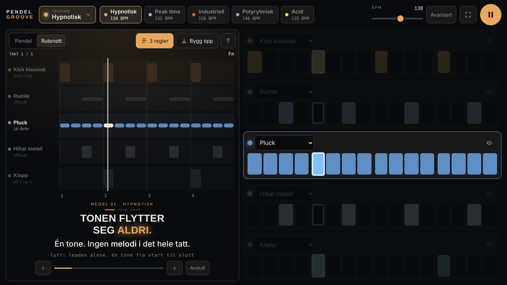
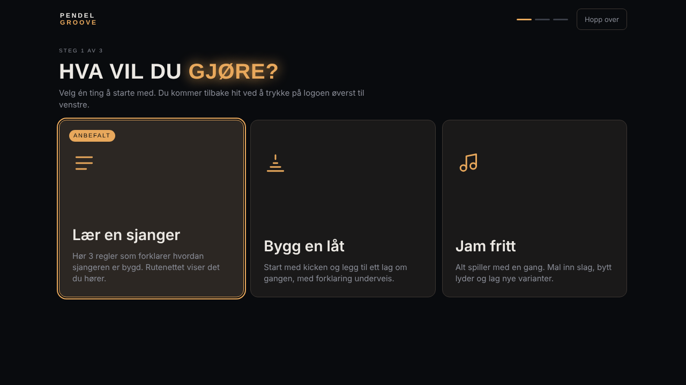
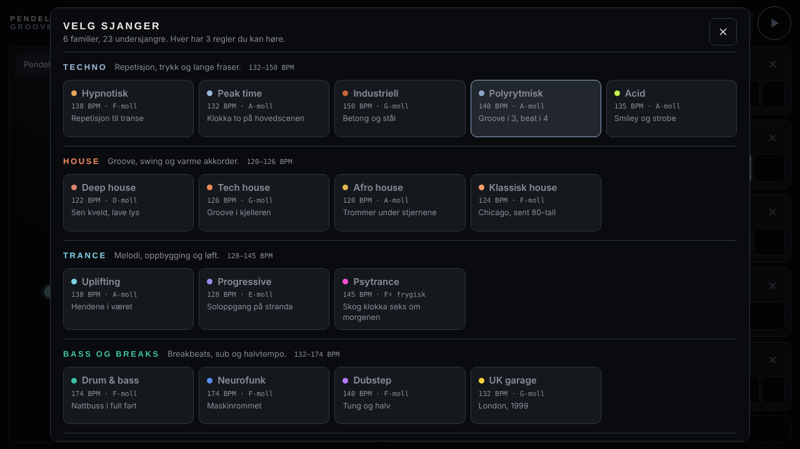
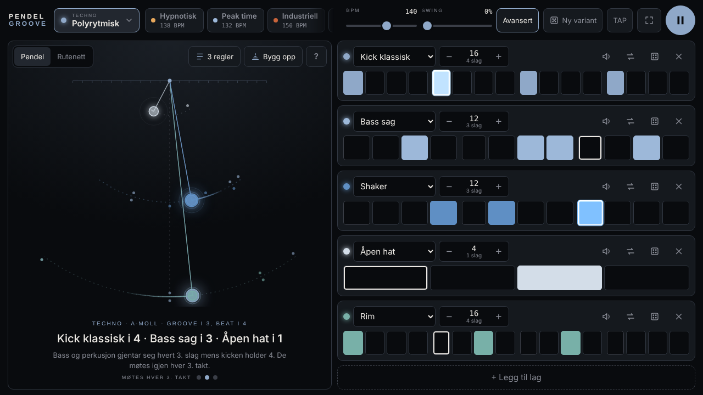

# Pendelgroove

**Lær hvordan elektronisk dansemusikk er bygd. Hvert lag i rytmen er en pendel du både ser og hører.**

Pendelgroove er et touch-instrument i nettleseren for polyrytmer og EDM-oppbygging. Du velger blant 23 undersjangre, fra hypnotisk techno til synthwave, og hører 3 regler som forklarer hver av dem. Underveis viser et rutenett eller svingende pendler hvordan lagene passer sammen.

*English summary: Pendelgroove is a touch-first web instrument that teaches how EDM genres are built. Each rhythm layer is a pendulum; 23 subgenres each come with three audible rules, a step grid and a build-up mode. Single static HTML file, no build step, all sounds synthesized with the Web Audio API. Designed and coded with Claude by Anthropic.*



> **Utviklet med Claude.** Design, kode, lyddesign, sjangerinnhold og dokumentasjon er laget av Claude (Anthropic) i samarbeid med [readymedia](https://github.com/readymedia). Se [Utviklet med Claude](#utviklet-med-claude).

## Innhold

- [Funksjoner](#funksjoner)
- [Slik bruker du den](#slik-bruker-du-den)
- [Kjør lokalt](#kjør-lokalt)
- [Publiser på Vercel](#publiser-på-vercel)
- [Prosjektstruktur](#prosjektstruktur)
- [Dokumentasjon](#dokumentasjon)
- [Utvikling](#utvikling)
- [Utviklet med Claude](#utviklet-med-claude)
- [Inspirasjon](#inspirasjon)

## Funksjoner

- **Oppstartsveiviser i 3 steg.** Du velger hva du vil gjøre (lære, bygge eller jamme), deretter stil og type. Appen starter rett i riktig modus.
- **23 undersjangre i 6 familier:** Techno, House, Trance, Bass og breaks, Hard og Disco og retro. Hver har tempo, swing, toneart, akkordprogresjon, fargepalett, lydpooler og mønstervarianter. Se hele katalogen i [docs/SJANGRE.md](docs/SJANGRE.md).
- **3 regler per sjanger med lyttedemo.** Demoen styrer avspillingen så regelen faktisk høres. Lag spiller alene, kommer inn sent eller faller ut i takt 3 og 4.
- **Bygg opp.** Låta bygges ett lag om gangen med forklaring av rytmen, og avsluttes med en oppsummering av polyrytmen.
- **To visninger.**
  - *Pendel:* pendelens lengde følger fysikken, så et mønster som er dobbelt så langt gir en pendel som er fire ganger så lang.
  - *Rutenett:* viser én takt med tonehøyde, akkordnavn, markør for slaget som spilles og trekanter der mønstre starter på nytt.
- **Sequencer for touch.** Du maler slag ved å dra fingeren og stiller lengden per lag fra 2 til 32 sekstendeler. Lyd kan byttes innen sjangeren, terningen gir nye mønstre og «Ny variant» endrer hele låta.
- **53 syntetiserte lyder** laget med Web Audio API. Bass og synth følger akkordene. Det er ingen lydfiler.
- **Enkel og avansert modus.** Swing, tap tempo, varianter og redigering av lag er skjult til du trykker «Avansert».
- **Ordliste** med 17 begreper, blant annet offbeat, halvtempo, 2-step, polyrytme, frygisk og gated reverb.
- **Installerbar som app (PWA-manifest)** med fullskjerm i liggende format. Skjermen holder seg våken mens musikken spiller.

| Veiviser | Sjangervelger | Pendel og jam |
|---|---|---|
|  |  |  |

## Slik bruker du den

1. **Hva vil du gjøre?**
   - *Lær en sjanger* starter de 3 reglene med rutenett.
   - *Bygg en låt* starter Bygg opp.
   - *Jam fritt* spiller alt og åpner avanserte kontroller.
2. **Velg stil.** Det er seks familier å velge mellom.
3. **Velg type.** Lyden starter med en gang.

Logoen øverst til venstre åpner veiviseren igjen. Sjangerknappen åpner hele katalogen. Snarveiene ved siden av den bytter mellom undersjangrene i samme familie.

| Handling | Slik gjør du det |
|---|---|
| Male inn eller fjerne slag | Dra fingeren over rutene |
| Dempe et lag | Trykk på pendelen eller lagnavnet i rutenettet, eller på høyttalerikonet |
| Neste eller forrige regel | ‹ › i bunnen av scenen, eller piltastene |
| Starte og stoppe | Play-knappen eller mellomrom |
| Tilbakestille sjangeren | Trykk på den aktive undersjangeren igjen (prikken viser at du har endret noe) |

## Kjør lokalt

Prosjektet er én statisk HTML-fil uten bygging og uten avhengigheter.

```bash
npm run dev        # serverer public/ på http://localhost:3000 (npx serve)
# eller
python3 -m http.server -d public 3000
```

Det går også an å åpne `public/index.html` direkte i nettleseren.

**Krav:** en moderne nettleser med Web Audio API, pointer events og canvas. Det vil si Chrome, Edge, Safari 15+ eller Firefox. Lyden starter først når du trykker på noe, fordi nettleseren krever det.

## Publiser på Vercel

**Via GitHub:** Importer repoet på [vercel.com/new](https://vercel.com/new) og velg Framework Preset **Other**. Du trenger ingen byggekommando, fordi `vercel.json` peker på `public/`. Hver push til `main` publiseres automatisk.

**Via CLI:**

```bash
npm i -g vercel
vercel          # forhåndsvisning
vercel --prod   # produksjon
```

`vercel.json` setter sikkerhetshoder, riktig MIME-type for manifestet og lang cache for ikonene.

## Prosjektstruktur

```
public/
  index.html              Hele appen: HTML, CSS og JavaScript i én fil
  manifest.webmanifest    PWA-manifest (fullskjerm, liggende)
  icon.svg, icon-*.png    App-ikoner
docs/
  ARKITEKTUR.md           Hvordan koden henger sammen
  DATAFORMAT.md           Slik legger du til sjangre, regler og lyder
  SJANGRE.md              Generert katalog over alle sjangre (npm run docs)
  img/                    Skjermbilder
scripts/
  extract.mjs             Leser sjangerdata ut av index.html (brukes av test og docs)
  gen-genre-docs.mjs      Genererer docs/SJANGRE.md
tests/
  validate.mjs            Syntaks- og datasjekk (npm test)
AGENTS.md                 Arbeidsinstruks for AI-agenter og utviklere
CLAUDE.md                 Peker Claude Code til AGENTS.md
CHANGELOG.md              Versjonshistorikk
vercel.json               Vercel-oppsett
```

## Dokumentasjon

| Dokument | For hvem | Innhold |
|---|---|---|
| [AGENTS.md](AGENTS.md) | AI-agenter og nye utviklere | Rask oversikt, kommandoer, regler som ikke må brytes, sjekkliste |
| [docs/ARKITEKTUR.md](docs/ARKITEKTUR.md) | Utviklere | Tilstand, timing, lydmotor, harmoni, leksjoner og tegning |
| [docs/DATAFORMAT.md](docs/DATAFORMAT.md) | Alle som legger til innhold | Felt for familie, undersjanger, lag, regel og lyd, med eksempler |
| [docs/SJANGRE.md](docs/SJANGRE.md) | Musikere og innholdsfolk | Alle 23 undersjangre med mønstre og regler |
| [CHANGELOG.md](CHANGELOG.md) | Alle | Hva som er endret og når |

## Utvikling

```bash
npm test         # sjekker syntaks og at all sjangerdata henger sammen
npm run docs     # oppdaterer docs/SJANGRE.md etter endringer i sjangerdata
```

Testene trenger bare Node 18 eller nyere og har ingen avhengigheter. Før du endrer noe, les [AGENTS.md](AGENTS.md). Den beskriver arbeidsflyten og hva som må sjekkes manuelt i nettleseren.

## Utviklet med Claude

Pendelgroove er designet og programmert av **Claude**, en AI-modell fra [Anthropic](https://www.anthropic.com), i en samtale med Magnus i readymedia i oktober 2026. Utviklingen gikk i korte runder der Magnus delte skjermbilder fra musikkvideoer og ønsker, og Claude bygde, testet i en headless nettleser og publiserte hver versjon. [CHANGELOG.md](CHANGELOG.md) viser rundene.

Claude har laget:
- arkitektur, all kode, lydsyntese og grafikk
- sjangerdataene: mønstre, akkorder og de 3 reglene med tekster
- veiviseren, testene og denne dokumentasjonen

Sjangerreglene er forenklinger laget for undervisning. De er ikke absolutte sannheter om sjangrene. Kontroller faglig innhold før du bruker det i undervisning.

Dokumentasjonen er skrevet slik at både mennesker og AI-agenter skal kunne ta over prosjektet. Agenter bør starte med [AGENTS.md](AGENTS.md).

## Inspirasjon

- Pendel-konseptet og «groove i 3, beat i 4» er inspirert av Nicko Shuos serie *How I make techno* (låta *Wrong Ways*, Extend Records). Det samme gjelder «3 regler for hypnotisk techno».
- Rutenett-visningen er inspirert av *One grid*-serien fra The Producers Classroom.

Ingen lyd, grafikk eller tekst fra disse er brukt. Alt i appen er laget fra bunnen av.

## Lisens

Lisens er ikke valgt ennå. Inntil en `LICENSE`-fil er lagt til, beholder readymedia alle rettigheter.
